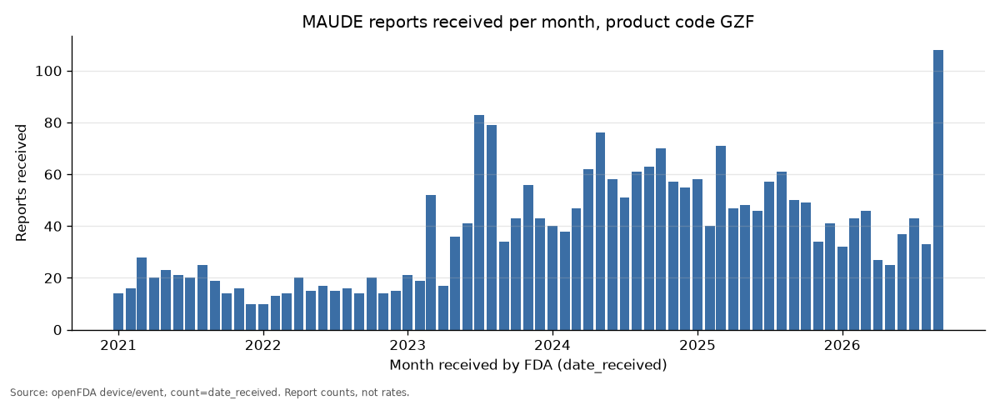

# maude-report-summary

A small command-line tool that turns the public openFDA device adverse event data (FDA's MAUDE database, short for Manufacturer and User Facility Device Experience) into a one-page report for one device product code: reports received per month, reports by event type per year, manufacturers by number of unique reports, and narrative themes from a capped sample of recent reports.
Every number in the report is computed in Python from saved openFDA responses; the optional Claude step only writes theme labels and descriptions. Its output is checked automatically for format, for the absence of digits and for report keys that belong to the sample sent, but nothing checks automatically what the labels and descriptions mean.

## Example output

The committed sample for product code GZF (*Stimulator, Peripheral Nerve, Implanted (Pain Relief)*) is [`examples/GZF/report.md`](examples/GZF/report.md), with its tables as CSV files and every raw openFDA response it used in [`examples/GZF/raw/`](examples/GZF/raw/).

**Reading the manufacturer table.** Names appear exactly as reported, so one company can sit on several rows. In this sample, Nalu Medical appears under five spellings that together cover 1,237 unique reports, more than the 959 on the top row. Treat the table as a list of reported names, not a ranking.



## How to run

You need Python 3.11 or later (pandas 3.1 requires it). The tool is tested on Python 3.12, the version used by the automated tests (CI, continuous integration). These steps are for macOS, Linux, or Windows with WSL (Windows Subsystem for Linux). On Windows, first install WSL by following [Microsoft's guide](https://learn.microsoft.com/en-us/windows/wsl/install), then type every command below in the Ubuntu window.

```bash
git clone https://github.com/nardevr/maude-report-summary.git && cd maude-report-summary
python3 -m venv .venv && . .venv/bin/activate && pip install -r requirements.txt
PYTHONPATH=src python -m maude_summary --product-code GZF --since 2021-01-01 --out reports/GZF --no-llm
```

The report is written to `reports/GZF/report.md`. No openFDA key is needed.

**Opening the report.** `report.md` is a Markdown file. Open it in Visual Studio Code (VS Code) and press Ctrl+Shift+V (Cmd+Shift+V on a Mac) to see it formatted. On WSL, go into the output folder with `cd reports/GZF` and type `explorer.exe .` to open it in Windows File Explorer. Typing `explorer.exe reports/GZF` may open your Documents folder instead.

**Next time.** In a new terminal you only need two lines before the run command: `cd maude-report-summary` and `. .venv/bin/activate`.

**Busy product codes.** One run can fetch at most 25,974 reports. A code with more stops with an error and writes a partial report. To pick a start date that fits, open `monthly_counts.csv` from that partial run, add up the months from the newest backwards until the total nears 25,000, and use that month as `--since`.

**Narrative themes (optional).** Put a Claude API key in the variable `MAUDE_ANTHROPIC_API_KEY`, either in your shell or in a `.env` file in the repo folder (`.env` is git-ignored), and drop `--no-llm`. The tool reads its key from that variable only and never from `ANTHROPIC_API_KEY`. The model defaults to `claude-haiku-5-5` and can be changed with `MAUDE_LLM_MODEL`. `--llm-sample N` sets how many recent reports are sent (default 30, maximum 50). Without a key and without `--no-llm`, the report says the themes step was skipped.

**Exit codes.** A failed openFDA fetch exits 1; a failed Claude step exits 0, with "Themes unavailable" shown in the report and the terminal.

**Tests** run offline, without an API key and without the `anthropic` package: `pytest -q`.

## How it works

- **Raw-record fetch.** The tool downloads every report for the product code and date window from `https://api.fda.gov/device/event.json`, 999 records per page, sorted by `date_received` (a run can reach at most 25,974 records; for codes above that, use a later `--since`). Each response is saved gzipped in `raw/` and listed in `raw/manifest.json` with its query URL and fetch time, so every number can be traced to a saved response.
- **Manufacturer metric.** A report's `device` field is a list, so counting manufacturer fields would count device entries, not reports. The tool counts the number of **unique reports** (`mdr_report_key`) naming each manufacturer, using only device entries with the selected product code. Names appear as reported (trimmed and upper-cased), so one company can show up on more than one row, and a report naming two manufacturers counts once for each. These are report counts, not rates, and not a ranking of safety.
- **Totals cross-check.** The report header compares the sum of the monthly counts (`count=date_received`), the search total (`meta.results.total`) and the number of records fetched. Event types per year come from the records and are checked against `count=event_type.exact`. A mismatch is shown, not hidden. A failed request is retried (after 1, 2 and 4 seconds) and otherwise reported as a failed section.
- **LLM guardrail.** Only the report keys and narrative texts of the most recent reports with narratives are sent to Claude, with instructions to describe only what the narratives say, make no causal claims, use no numbers and give no medical advice. The reply must be a JSON object with one to five themes, each with exactly a label (up to 60 characters), a one-sentence description (up to 200 characters) and report keys from the sample; any digit in a label or description, or any other deviation, rejects the whole reply and the report shows "Themes unavailable: model output failed validation" with the failed rule. The count of reports per theme is computed by the tool from the cited keys.

## Limitations

From openFDA (<https://open.fda.gov/apis/device/event/>):

- "a causal relationship cannot be established between product and reactions listed in a report."
- "Adverse event reports submitted to FDA do not undergo extensive validation or verification."
- "potential under-reporting of events and lack of information about frequency of device use."

From FDA's MAUDE page (<https://www.fda.gov/medical-devices/mandatory-reporting-requirements-manufacturers-importers-and-device-user-facilities/about-manufacturer-and-user-facility-device-experience-maude-database>):

- "MDR data is not intended to be used either to evaluate rates of adverse events, evaluate a change in event rates over time, or to compare adverse event occurrence rates across devices."

MDR stands for Medical Device Report, one report in the MAUDE database.

The monthly chart shows how many reports FDA received each month, not event rates or trends in events.

In addition, report counts reflect reporting behaviour (for example manufacturer reporting practice, recalls and publicity) as well as events, and duplicate reports can occur.

## Data credit

Data provided by the U.S. Food and Drug Administration. Source: openFDA device adverse event API (<https://open.fda.gov/apis/device/event/>).

## Licence

MIT. See [LICENSE](LICENSE).

## Disclaimer

Independent personal project, not affiliated with or endorsed by FDA, not medical advice.

Built with Claude Code and reviewed by an independent LLM auditor.
