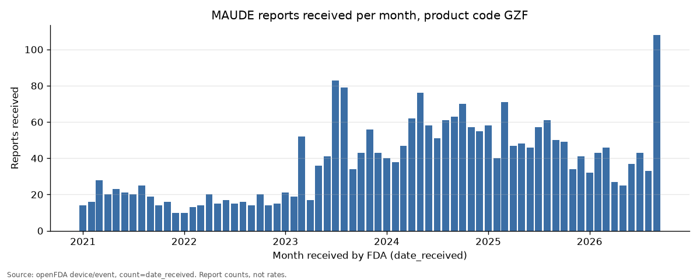

# MAUDE report summary: product code GZF

| Field | Value |
|:---|:---|
| Product code | GZF |
| Generic name | PERIPHERAL NERVE STIMULATOR (most frequent `device.generic_name` on matching device entries) |
| Query window | `date_received` 2021-01-01 to 2026-11-03 |
| openFDA last updated | 2026-10-20 (`meta.last_updated`) |
| Run timestamp | 2026-11-03 03:53:49 UTC / 2026-11-03 11:53:49 Singapore (UTC+8) |
| Totals check | MATCH: sum of monthly counts 2,607 = search total (`meta.results.total`) 2,607 = raw records fetched 2,607 (2,607 unique `mdr_report_key`) |
| Event-type check | MATCH: window totals from the raw-record pivot equal `count=event_type.exact` |

## 1. Reports received per month

| Year | Jan | Feb | Mar | Apr | May | Jun | Jul | Aug | Sep | Oct | Nov | Dec | Total |
|:---|---:|---:|---:|---:|---:|---:|---:|---:|---:|---:|---:|---:|---:|
| 2021 | 14 | 16 | 28 | 20 | 23 | 21 | 20 | 25 | 19 | 14 | 16 | 10 | 226 |
| 2022 | 10 | 13 | 14 | 20 | 15 | 17 | 15 | 16 | 14 | 20 | 14 | 15 | 183 |
| 2023 | 21 | 19 | 52 | 17 | 36 | 41 | 83 | 79 | 34 | 43 | 56 | 43 | 524 |
| 2024 | 40 | 38 | 47 | 62 | 76 | 58 | 51 | 61 | 63 | 70 | 57 | 55 | 678 |
| 2025 | 58 | 40 | 71 | 47 | 48 | 46 | 57 | 61 | 50 | 49 | 34 | 41 | 602 |
| 2026 | 32 | 43 | 46 | 27 | 25 | 37 | 43 | 33 | 108 |  |  |  | 394 |

Source: `raw/count_date_received.json.gz` (`count=date_received`), aggregated to calendar months. Last month with data: 2026-09; the latest month may be incomplete. Full series in `monthly_counts.csv`.

## 2. Reports by event type per year

| Year | Death | Injury | Malfunction | Other | Total |
|:---|---:|---:|---:|---:|---:|
| 2021 | 2 | 221 | 3 | 0 | 226 |
| 2022 | 1 | 181 | 1 | 0 | 183 |
| 2023 | 2 | 519 | 3 | 0 | 524 |
| 2024 | 2 | 674 | 1 | 1 | 678 |
| 2025 | 2 | 597 | 3 | 0 | 602 |
| 2026 | 6 | 340 | 48 | 0 | 394 |

Each report counts once, under the `event_type` value as reported, by year of `date_received`. Source: the raw record pages in `raw/` (`records_page*.json.gz`), cross-checked against `raw/count_event_type_exact.json.gz`.

## 3. Top manufacturers by number of unique reports

| Manufacturer (as reported) | Unique reports |
|:---|---:|
| CURONIX LLC | 959 |
| NALU MEDICAL, INC | 645 |
| NALU MEDICAL INC | 583 |
| STIMWAVE TECHNOLOGIES INC. | 372 |
| BIOVENTUS LLC | 8 |
| NALU MEDICAL | 5 |
| UNKNOWN | 5 |
| (not stated) | 4 |
| BIONESS | 3 |
| MEDTRONIC NEUROMODULATION | 3 |
| (no device entry with product code GZF) | 0 |

Names appear as reported, so one company can show up on more than one row.

A report can name more than one manufacturer, so this column can sum to more than the total.

Unique reports = distinct `mdr_report_key` naming the manufacturer (`manufacturer_d_name`, trimmed and upper-cased) on a device entry with product code GZF. These are report counts, not rates, and not a ranking of safety. Source: the raw record pages in `raw/`.

15 further manufacturer names are listed in `top_manufacturers.csv`.

## 4. Narrative themes

Themes in the narratives of the 30 most recent reports with narrative text (`date_received` 2026-09-16 to 2026-09-30), summarised by `claude-haiku-5-5`. Labels and descriptions are written by the model and describe what the narratives say; they are not causal findings. The report count for each theme is computed by this tool from the cited report keys. Input sent: `raw/llm_request.json`. Model output: `raw/llm_response.json`.

- **Lead, connector, or component damage reported** (8 reports). Narratives describe leads, introducers, connectors, or implanted components reported as fractured, torn, broken, or damaged during or after handling.  
  Report keys: 50949318, 50948697, 50869095, 50869092, 50899604, 50899606, 50840744, 50867030
- **Infection and incision site complications** (9 reports). Narratives describe suspected or treated infections, eroding or reopened incisions, exposed leads, and bleeding at the implant site.  
  Report keys: 50937584, 50936648, 50928010, 50901693, 50900578, 50885184, 50804957, 50808902, 50886588
- **High impedance and red ohms readings** (7 reports). Narratives describe impedance checks showing high or red readings on one or more contacts or leads during implant, programming, or follow-up.  
  Report keys: 50947936, 50867972, 50867030, 50842915, 50842912, 50858500, 50839747
- **Shocking, burning, or changing stimulation** (4 reports). Narratives describe patients reporting shocks, burning sensations, or changes in amplitude or stimulation, along with related back spasm reports.  
  Report keys: 50885794, 50839514, 50947936, 50871705
- **Patient removal, nonuse, or aborted procedures** (4 reports). Narratives describe patients removing trial leads or not using the system, procedures aborted for positioning concerns, and patients who were lost to follow-up.  
  Report keys: 50872338, 50869437, 50812902, 50792854

A report can appear under more than one theme, so theme counts can add up to more than the sample size.

## 5. Limitations

From openFDA (<https://open.fda.gov/apis/device/event/>):

- "a causal relationship cannot be established between product and reactions listed in a report."
- "Adverse event reports submitted to FDA do not undergo extensive validation or verification."
- "potential under-reporting of events and lack of information about frequency of device use."

From FDA's MAUDE page (<https://www.fda.gov/medical-devices/mandatory-reporting-requirements-manufacturers-importers-and-device-user-facilities/manufacturer-and-user-facility-device-experience-database-maude>):

- MDR (Medical Device Report) data "is not intended to be used either to evaluate rates of adverse events" or "to compare adverse event occurrence rates across devices."

In addition: report counts reflect reporting behaviour (for example manufacturer reporting
practice, recalls and publicity) as well as events. Duplicate reports can occur.

---

Data provided by the U.S. Food and Drug Administration. Source: openFDA device adverse event API (<https://open.fda.gov/apis/device/event/>). Every raw response used is saved in `raw/` and listed in `raw/manifest.json` with its query URL and fetch time.

Independent personal project, not affiliated with or endorsed by FDA. Not medical advice.
